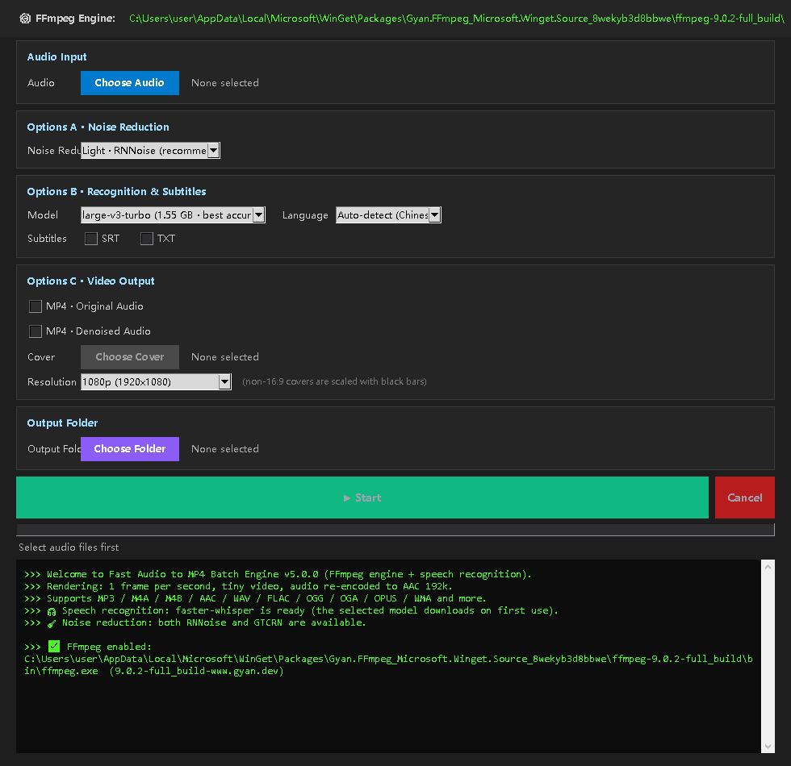

# Mp3 to MP4

**English** | [简体中文](README.zh-CN.md) | [繁體中文](README.zh-TW.md)


Mp3 to MP4 is a Windows desktop tool that pairs audio files with a still cover image and exports MP4 videos. It can also transcribe audio into SRT and TXT subtitles and reduce background noise before recognition or export.



## Contents

- [Execution model](#execution-model)
- [Common combinations](#common-combinations)
- [Output files and naming](#output-files-and-naming)
- [Interface language](#interface-language)
- [Requirements](#requirements)
- [Installation](#installation)
- [Data and cache](#data-and-cache)
- [Project structure](#project-structure)
- [Development and testing](#development-and-testing)
- [Known limitations](#known-limitations)
- [License](#license)
- [Credits](#credits)

## Execution model

Select one or more audio files, configure the three option groups below, then press **Start** once. Files are processed one after another, and each file runs only the steps its options require.

| Group | Setting | Choices |
| --- | --- | --- |
| A · Noise reduction | Strength | Off / Light (RNNoise) / Strong (GTCRN neural network) |
| B · Recognition and subtitles | Model | Off, tiny, base, small, medium, large-v3-turbo |
| | Spoken language | Auto-detect / Chinese / English |
| | Subtitle formats | SRT and TXT, selected independently |
| C · Video output | Video files | MP4 with the original audio and/or MP4 with the denoised audio |
| | Cover image | JPG, PNG, BMP, WEBP |
| | Resolution | 1080p (default) / 720p / original image size |

- Noise reduction runs at most once per file; subtitles and the denoised video reuse that result.
- A cover image is required only when a video output is selected.
- The denoised-video option requires noise reduction to be on; when noise reduction is Off, that option is ignored.
- Accepted audio formats are the ones FFmpeg can decode, including MP3, M4A, M4B, AAC, WAV, FLAC, OGG, OGA, OPUS, WMA, AIFF, APE, WV, AMR, AC3, and DTS.

Defaults: 1080p, large-v3-turbo, auto-detect, and light RNNoise.

## Common combinations

| Goal | What to select |
| --- | --- |
| Subtitles only | Any model except Off; check SRT and/or TXT; no cover needed |
| MP4 with the original audio | Check "MP4 · Original Audio"; choose a cover |
| MP4 with the denoised audio | Set noise reduction to Light or Strong; check "MP4 · Denoised Audio"; choose a cover |
| Everything | Check both MP4 options and at least one subtitle format, and set noise reduction to Light or Strong |

To preview noise reduction, set it to Light or Strong and leave every other option unchecked. The app then exports only `recording_denoised.wav`, which you can listen to before producing a video.

## Output files and naming

Output goes to the selected output folder. If no folder is selected, it goes to the folder of the first audio file.

For an input named `recording.mp3`:

| Output | File name |
| --- | --- |
| Subtitles | `recording.srt`, `recording.txt` |
| Video with the original audio | `recording.mp4` |
| Denoised audio | `recording_denoised.wav` (48 kHz, stereo, 16-bit PCM) |
| Video with the denoised audio | `recording_denoised.mp4` |

Existing files are never overwritten. If a name is already taken, ` (1)`, ` (2)`, and so on are appended before the extension.

Video is encoded as H.264 (libx264) at 1 frame per second, with AAC 192 kbps audio and the `faststart` flag. In 1080p and 720p modes, covers that are not 16:9 are scaled down and padded with black bars; original-size mode keeps the source dimensions, rounded down to even numbers. SRT and TXT subtitles are separate files; they are not burned into the video.

## Interface language

The interface ships in Simplified Chinese, Traditional Chinese, and English. Use the selector in the top-right corner; the change applies immediately and does not restart the app. The first launch starts in Simplified Chinese, and the selection is remembered. Log lines that have already been written keep the language they were printed in and are not retranslated.

## Requirements

- Windows 10 or 11
- Python 3.10 or newer
- FFmpeg with the `libx264` and `aac` encoders

FFmpeg is not bundled with the application and must be installed separately.

## Installation

### Option 1: run from a clone

```bash
git clone https://github.com/YOUR_USERNAME/Mp3_to_Mp4.git
cd Mp3_to_Mp4
pip install -r requirements.txt
python MP3toMP4.py
```

### Option 2: install as a package

```bash
pip install .
mp3tom4
```

`mp3tom4-gui` starts the same application.

### Option 3: install with optional features

```bash
pip install ".[full]"
```

This adds `sherpa-onnx` for strong GTCRN noise reduction and `imageio-ffmpeg` as an additional FFmpeg source.

### FFmpeg on Windows

```powershell
winget install Gyan.FFmpeg
```

The application searches, in order: the last path saved in the configuration, `ffmpeg.exe` next to the program, `PATH`, winget package directories, common installation paths, and `imageio-ffmpeg`. You can also click **Change** at the top of the window to select `ffmpeg.exe` manually. A build is accepted only if it provides both `libx264` and `aac`; otherwise the application reports which encoder is missing. Installing `imageio-ffmpeg` with pip adds one more fallback source.

## Data and cache

| Data | Location |
| --- | --- |
| Configuration | `%APPDATA%\Mp3ToMp4\config.json` |
| Model cache | `%APPDATA%\Mp3ToMp4\models\` (with `whisper\` and `denoise\` subfolders) |

The configuration file stores the FFmpeg path, the last cover image, the output folder, the resolution, the interface language, and the recognition settings.

The first run with a given recognition model downloads its weights into `models\whisper\`:

| Model | Download size |
| --- | --- |
| large-v3-turbo | 1.55 GB |
| medium | 1.46 GB |
| small | 464 MB |
| base | 141 MB |
| tiny | 75 MB |

The download requires a network connection and can take minutes to tens of minutes. The log reports it before it starts, so an apparently idle first run is usually a download in progress. Models stay on disk between runs, and deleting the folder is safe. The two small noise-reduction models are downloaded into `models\denoise\` on first use.

## Project structure

```text
mp3tom4/
├── config.py       constants, configuration, paths
├── i18n.py         localization framework
├── ffmpeg.py       FFmpeg discovery, filters, muxing
├── denoise.py      noise reduction (RNNoise / GTCRN)
├── asr.py          speech recognition (faster-whisper)
├── subtitle.py     SRT / TXT generation
├── pipeline.py     job orchestration
├── ui/             interface
└── locale/         translation catalogs
tests/              pytest suite
```

## Development and testing

```bash
pip install -e ".[dev]"
pytest tests/ -v
```

Tests that invoke a real FFmpeg binary are marked `integration` and can be skipped with `pytest tests/ -m "not integration"`.

## Known limitations

1. **Strong noise reduction loses high frequencies.** GTCRN works on 16 kHz audio, and the result is upsampled to 48 kHz. High-frequency detail is genuinely lost and the output can sound dull. Use Light RNNoise when fidelity matters, and Strong GTCRN when noise removal matters more.
2. **Cancellation is not instantaneous.** FFmpeg-based steps such as noise reduction and muxing stop immediately, but Whisper inference is a blocking call, so cancellation waits for the current segment to finish.
3. **The first transcription is slow.** It includes downloading the model and can take minutes to tens of minutes depending on the network and model size.
4. **Subtitles are sidecar files.** They are not burned into the video picture.
5. **Log history is not retranslated.** Switching the interface language leaves existing log lines in their original language.

## License

GPL-3.0-or-later. See [LICENSE](LICENSE) for the full text. You may use, modify, and redistribute the software; if you distribute a modified version, it must be released under the same license.

## Credits

- [faster-whisper](https://github.com/SYSTRAN/faster-whisper) — speech recognition
- [GTCRN / sherpa-onnx](https://github.com/k2-fsa/sherpa-onnx) — strong noise reduction
- [RNNoise](https://jmvalin.ca/demos/rnnoise/) — light noise reduction
- [FFmpeg](https://ffmpeg.org/) — decoding, encoding, and muxing
