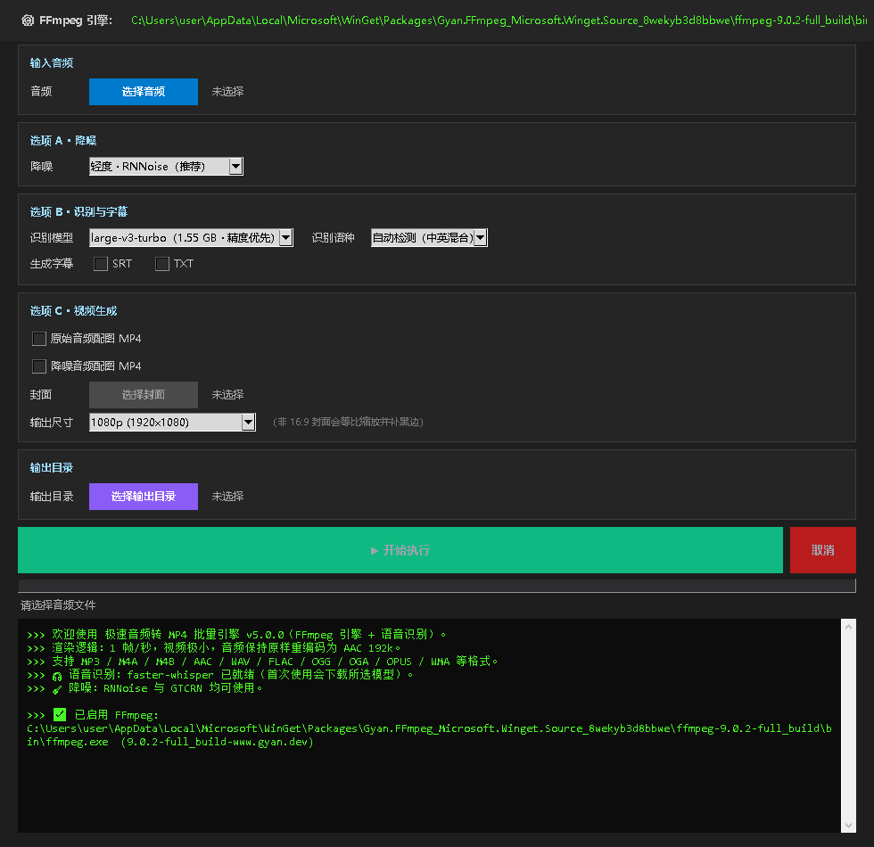

# Mp3 to MP4

**English** | [简体中文](README.zh-CN.md) | [繁體中文](README.zh-TW.md)


Mp3 to MP4 是一个 Windows 桌面工具：把音频文件配上静态封面图导出 MP4 视频，也可以把音频识别成 SRT / TXT 字幕。识别和导出之前都可以先做降噪。



## 目录

- [执行模型](#执行模型)
- [典型组合](#典型组合)
- [产物与命名](#产物与命名)
- [界面语言](#界面语言)
- [环境要求](#环境要求)
- [安装](#安装)
- [数据与缓存](#数据与缓存)
- [项目结构](#项目结构)
- [开发与测试](#开发与测试)
- [已知限制](#已知限制)
- [许可证](#许可证)
- [致谢](#致谢)

## 执行模型

选择一个或多个音频文件，在三组互相独立的选项里勾选要做的事，然后点一次「开始执行」。文件按顺序逐个处理，每个文件只执行其选项对应的步骤。

| 选项组 | 设置 | 可选值 |
| --- | --- | --- |
| A · 降噪 | 强度 | 关闭 / 轻度（RNNoise）/ 强力（GTCRN 神经网络） |
| B · 识别与字幕 | 模型 | 关闭、tiny、base、small、medium、large-v3-turbo |
| | 识别语种 | 自动检测 / 中文 / 英文 |
| | 字幕格式 | SRT 与 TXT，可分别勾选 |
| C · 视频生成 | 视频文件 | 原始音频配图 MP4 和/或降噪音频配图 MP4 |
| | 封面图片 | JPG、PNG、BMP、WEBP |
| | 输出尺寸 | 1080p（默认）/ 720p / 原图尺寸 |

- 降噪对每个文件最多执行一次，字幕和降噪视频都复用这次结果。
- 只有勾选视频输出时才需要封面图。
- 勾选「降噪音频配图 MP4」要求降噪不为「关闭」；降噪关闭时该项会被忽略。
- 支持 FFmpeg 能解码的音频格式，包括 MP3、M4A、M4B、AAC、WAV、FLAC、OGG、OGA、OPUS、WMA、AIFF、APE、WV、AMR、AC3、DTS。

默认值：1080p、large-v3-turbo、自动检测、轻度 RNNoise 降噪。

## 典型组合

| 想要的结果 | 勾选方式 |
| --- | --- |
| 只要字幕 | 模型选非「关闭」；勾选 SRT 和/或 TXT；不需要封面 |
| 原声转 MP4 | 勾选「原始音频配图 MP4」；选择封面 |
| 降噪后转 MP4 | 降噪选轻度或强力；勾选「降噪音频配图 MP4」；选择封面 |
| 全都要 | 勾选两个 MP4 和至少一种字幕格式，降噪选轻度或强力 |

想先试听降噪效果，可以把降噪设为轻度或强力，其他选项全部不勾。程序只导出 `录音_denoised.wav`，听完再决定要不要做视频。

## 产物与命名

所有产物写入「输出目录」。没有选择输出目录时，使用第一个音频文件所在的目录。

以 `录音.mp3` 为例：

| 产物 | 文件名 |
| --- | --- |
| 字幕 | `录音.srt`、`录音.txt` |
| 原声视频 | `录音.mp4` |
| 降噪音频 | `录音_denoised.wav`（48 kHz / 立体声 / 16-bit PCM） |
| 降噪视频 | `录音_denoised.mp4` |

已存在的文件不会被覆盖。文件名被占用时，会在扩展名前追加 ` (1)`、` (2)` 等序号。

视频使用 H.264（libx264）编码，1 帧/秒，音频为 AAC 192 kbps，并启用 `faststart`。1080p 和 720p 模式下，非 16:9 的封面会等比缩放并补黑边；原图尺寸模式保留封面原始尺寸，宽高向下取整为偶数。SRT 和 TXT 是外挂字幕文件，不会烧录进画面。

## 界面语言

内置简体中文、繁體中文、English。右上角可切换，切换后即时生效，不需要重启程序。首次启动默认简体中文，之后会记住你的选择。已经输出的历史日志不会随语言切换回译。

## 环境要求

- Windows 10 / 11
- Python 3.10 或更高
- FFmpeg，且需要 `libx264` 和 `aac` 编码器

程序本身不包含 FFmpeg，需要单独安装。

## 安装

### 方式一：克隆后直接运行

```bash
git clone https://github.com/YOUR_USERNAME/Mp3_to_Mp4.git
cd Mp3_to_Mp4
pip install -r requirements.txt
python MP3toMP4.py
```

### 方式二：作为 Python 包安装

```bash
pip install .
mp3tom4
```

`mp3tom4-gui` 启动的是同一个程序。

### 方式三：安装完整功能

```bash
pip install ".[full]"
```

这会额外安装 `sherpa-onnx`（强力 GTCRN 降噪）和 `imageio-ffmpeg`（FFmpeg 的额外来源）。

### Windows 安装 FFmpeg

```powershell
winget install Gyan.FFmpeg
```

程序会按以下顺序探测：配置文件里上次使用的路径、程序所在目录的 `ffmpeg.exe`、`PATH`、winget 包目录、常见安装路径、`imageio-ffmpeg`。也可以点界面顶部的「更换」手动指定 `ffmpeg.exe`。只有同时提供 `libx264` 和 `aac` 的版本才会被接受，否则程序会明确提示缺哪个编码器。用 pip 安装 `imageio-ffmpeg` 可以再多一个兜底来源。

## 数据与缓存

| 数据 | 位置 |
| --- | --- |
| 配置文件 | `%APPDATA%\Mp3ToMp4\config.json` |
| 模型缓存 | `%APPDATA%\Mp3ToMp4\models\`（内含 `whisper\` 与 `denoise\`） |

配置文件保存 FFmpeg 路径、上次使用的封面、输出目录、输出尺寸、界面语言和识别相关设置。

首次使用某个识别模型时，程序会自动下载权重到 `models\whisper\`：

| 模型 | 下载体积 |
| --- | --- |
| large-v3-turbo | 1.55 GB |
| medium | 1.46 GB |
| small | 464 MB |
| base | 141 MB |
| tiny | 75 MB |

下载需要联网，耗时可能从几分钟到几十分钟。程序会在开始前写入日志，所以首次运行看起来没反应时，通常是在下载。模型会保留在磁盘上，整个目录可以安全删除。两个小体积降噪模型会在首次使用时下载到 `models\denoise\`。

## 项目结构

```text
mp3tom4/
├── config.py      常量、配置读写、路径
├── i18n.py        多语言框架
├── ffmpeg.py      FFmpeg 探测、滤镜、封装
├── denoise.py     降噪（RNNoise / GTCRN）
├── asr.py         语音识别（faster-whisper）
├── subtitle.py    SRT / TXT 生成
├── pipeline.py    任务编排
├── ui/            界面
└── locale/        三语词条
tests/             pytest 测试套件
```

## 开发与测试

```bash
pip install -e ".[dev]"
pytest tests/ -v
```

调用真实 FFmpeg 的用例标记为 `integration`，可以用 `pytest tests/ -m "not integration"` 跳过。

## 已知限制

1. **强力降噪会损失高频。** GTCRN 按 16 kHz 处理，结果再升采样到 48 kHz，高频细节是真的丢了，听感会偏闷。要保音质选轻度 RNNoise，要降噪力度选强力 GTCRN。
2. **取消不是瞬时的。** 降噪和封装这类 FFmpeg 步骤可以立刻终止，但 Whisper 推理是阻塞调用，取消需要等当前这句识别完成。
3. **首次识别耗时长。** 包含模型下载，可能几分钟到几十分钟，取决于网络和模型大小。
4. **字幕是外挂文件。** 不会烧录进视频画面。
5. **历史日志不回译。** 切换界面语言后，已经输出的日志保持原语言。

## 许可证

GPL-3.0-or-later，完整文本见 [LICENSE](LICENSE)。你可以自由使用、修改和分发；如果分发修改后的版本，必须以相同许可证开源。

## 致谢

- [faster-whisper](https://github.com/SYSTRAN/faster-whisper) — 语音识别
- [GTCRN / sherpa-onnx](https://github.com/k2-fsa/sherpa-onnx) — 强力降噪
- [RNNoise](https://jmvalin.ca/demos/rnnoise/) — 轻度降噪
- [FFmpeg](https://ffmpeg.org/) — 解码、编码与封装
