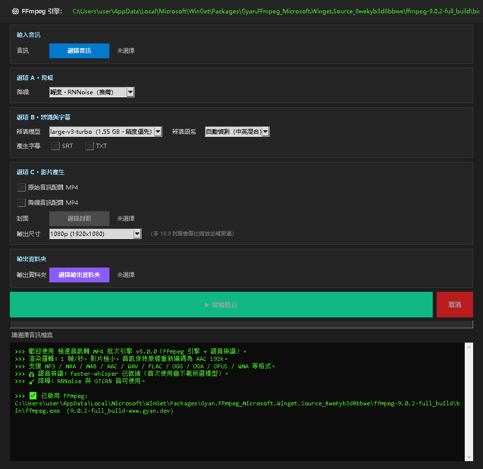

# Mp3 to MP4

**English** | [简体中文](README.zh-CN.md) | [繁體中文](README.zh-TW.md)


Mp3 to MP4 是一個 Windows 桌面工具：把音訊檔案配上靜態封面圖片匯出 MP4 影片，也可以把音訊辨識成 SRT / TXT 字幕。辨識和匯出之前都可以先做降噪。



## 目錄

- [執行模型](#執行模型)
- [常見組合](#常見組合)
- [產物與命名](#產物與命名)
- [介面語言](#介面語言)
- [系統需求](#系統需求)
- [安裝](#安裝)
- [資料與快取](#資料與快取)
- [專案結構](#專案結構)
- [開發與測試](#開發與測試)
- [已知限制](#已知限制)
- [授權條款](#授權條款)
- [致謝](#致謝)

## 執行模型

選擇一個或多個音訊檔案，在三組互相獨立的選項裡勾選要做的事，然後按一次「開始執行」。檔案會依序逐個處理，每個檔案只執行其選項對應的步驟。

| 選項組 | 設定 | 可選值 |
| --- | --- | --- |
| A · 降噪 | 強度 | 關閉 / 輕度（RNNoise）/ 強力（GTCRN 神經網路） |
| B · 辨識與字幕 | 模型 | 關閉、tiny、base、small、medium、large-v3-turbo |
| | 辨識語系 | 自動偵測 / 中文 / 英文 |
| | 字幕格式 | SRT 與 TXT，可分開勾選 |
| C · 影片產生 | 影片檔案 | 原始音訊配圖 MP4 和/或降噪音訊配圖 MP4 |
| | 封面圖片 | JPG、PNG、BMP、WEBP |
| | 輸出尺寸 | 1080p（預設）/ 720p / 原圖尺寸 |

- 降噪對每個檔案最多執行一次，字幕和降噪影片都重複使用這次結果。
- 只有勾選影片輸出時才需要封面圖片。
- 勾選「降噪音訊配圖 MP4」要求降噪不為「關閉」；降噪關閉時該項會被忽略。
- 支援 FFmpeg 能解碼的音訊格式，包括 MP3、M4A、M4B、AAC、WAV、FLAC、OGG、OGA、OPUS、WMA、AIFF、APE、WV、AMR、AC3、DTS。

預設值：1080p、large-v3-turbo、自動偵測、輕度 RNNoise 降噪。

## 常見組合

| 想要的結果 | 勾選方式 |
| --- | --- |
| 只要字幕 | 模型選非「關閉」；勾選 SRT 和/或 TXT；不需要封面 |
| 原聲轉 MP4 | 勾選「原始音訊配圖 MP4」；選擇封面 |
| 降噪後轉 MP4 | 降噪選輕度或強力；勾選「降噪音訊配圖 MP4」；選擇封面 |
| 全都要 | 勾選兩個 MP4 和至少一種字幕格式，降噪選輕度或強力 |

想先試聽降噪效果，可以把降噪設為輕度或強力，其他選項全部不勾。程式只會匯出 `錄音_denoised.wav`，聽完再決定要不要做影片。

## 產物與命名

所有產物寫入「輸出資料夾」。沒有選擇輸出資料夾時，使用第一個音訊檔案所在的資料夾。

以 `錄音.mp3` 為例：

| 產物 | 檔案名稱 |
| --- | --- |
| 字幕 | `錄音.srt`、`錄音.txt` |
| 原聲影片 | `錄音.mp4` |
| 降噪音訊 | `錄音_denoised.wav`（48 kHz / 立體聲 / 16-bit PCM） |
| 降噪影片 | `錄音_denoised.mp4` |

已存在的檔案不會被覆寫。檔案名稱被占用時，會在副檔名前加上 ` (1)`、` (2)` 等序號。

影片使用 H.264（libx264）編碼，1 幀/秒，音訊為 AAC 192 kbps，並啟用 `faststart`。1080p 和 720p 模式下，非 16:9 的封面會等比縮放並補黑邊；原圖尺寸模式保留封面原始尺寸，寬高向下取整為偶數。SRT 和 TXT 是外掛字幕檔案，不會燒錄進畫面。

## 介面語言

內建簡體中文、繁體中文、English。右上角可切換，切換後立即生效，不需要重新啟動程式。首次啟動預設簡體中文，之後會記住你的選擇。已經輸出的歷史日誌不會隨語言切換回譯。

## 系統需求

- Windows 10 / 11
- Python 3.10 或更新版本
- FFmpeg，且需要 `libx264` 和 `aac` 編碼器

程式本身不包含 FFmpeg，需要另外安裝。

## 安裝

### 方式一：取得專案後直接執行

```bash
git clone https://github.com/zqd9853572002/Mp3_to_Mp4.git
cd Mp3_to_Mp4
pip install -r requirements.txt
python MP3toMP4.py
```

### 方式二：安裝成 Python 套件

```bash
pip install .
mp3tom4
```

`mp3tom4-gui` 啟動的是同一個程式。

### 方式三：安裝完整功能

```bash
pip install ".[full]"
```

這會額外安裝 `sherpa-onnx`（強力 GTCRN 降噪）和 `imageio-ffmpeg`（FFmpeg 的額外來源）。

### Windows 安裝 FFmpeg

```powershell
winget install Gyan.FFmpeg
```

程式會依下列順序偵測：設定檔裡上次使用的路徑、程式所在資料夾的 `ffmpeg.exe`、`PATH`、winget 套件目錄、常見安裝路徑、`imageio-ffmpeg`。也可以點介面頂端的「更換」手動指定 `ffmpeg.exe`。只有同時提供 `libx264` 和 `aac` 的版本才會被接受，否則程式會明確提示缺少哪個編碼器。用 pip 安裝 `imageio-ffmpeg` 可以再多一個備援來源。

## 資料與快取

| 資料 | 位置 |
| --- | --- |
| 設定檔 | `%APPDATA%\Mp3ToMp4\config.json` |
| 模型快取 | `%APPDATA%\Mp3ToMp4\models\`（內含 `whisper\` 與 `denoise\`） |

設定檔會保存 FFmpeg 路徑、上次使用的封面、輸出資料夾、輸出尺寸、介面語言和辨識相關設定。

首次使用某個辨識模型時，程式會自動下載權重到 `models\whisper\`：

| 模型 | 下載大小 |
| --- | --- |
| large-v3-turbo | 1.55 GB |
| medium | 1.46 GB |
| small | 464 MB |
| base | 141 MB |
| tiny | 75 MB |

下載需要連網，耗時可能從幾分鐘到幾十分鐘。程式會在開始前寫入日誌，所以首次執行看起來沒反應時，通常是在下載。模型會保留在磁碟上，整個目錄可以安全刪除。兩個小體積降噪模型會在首次使用時下載到 `models\denoise\`。

## 專案結構

```text
mp3tom4/
├── config.py      常數、設定讀寫、路徑
├── i18n.py        多語言框架
├── ffmpeg.py      FFmpeg 偵測、濾鏡、封裝
├── denoise.py     降噪（RNNoise / GTCRN）
├── asr.py         語音辨識（faster-whisper）
├── subtitle.py    SRT / TXT 產生
├── pipeline.py    任務編排
├── ui/            介面
└── locale/        三語詞條
tests/             pytest 測試套件
```

## 開發與測試

```bash
pip install -e ".[dev]"
pytest tests/ -v
```

呼叫真實 FFmpeg 的案例標記為 `integration`，可以用 `pytest tests/ -m "not integration"` 跳過。

## 已知限制

1. **強力降噪會損失高頻。** GTCRN 以 16 kHz 處理，結果再升取樣到 48 kHz，高頻細節是真的丟失，聽感會偏悶。要保音質選輕度 RNNoise，要降噪力度選強力 GTCRN。
2. **取消不是即時的。** 降噪和封裝這類 FFmpeg 步驟可以立刻終止，但 Whisper 推論是阻塞呼叫，取消需要等目前這句辨識完成。
3. **首次辨識耗時長。** 包含模型下載，可能幾分鐘到幾十分鐘，取決於網路和模型大小。
4. **字幕是外掛檔案。** 不會燒錄進影片畫面。
5. **歷史日誌不回譯。** 切換介面語言後，已經輸出的日誌維持原語言。

## 授權條款

GPL-3.0-or-later，完整文本見 [LICENSE](LICENSE)。你可以自由使用、修改和散布；如果散布修改後的版本，必須以相同授權條款開源。

## 致謝

- [faster-whisper](https://github.com/SYSTRAN/faster-whisper) — 語音辨識
- [GTCRN / sherpa-onnx](https://github.com/k2-fsa/sherpa-onnx) — 強力降噪
- [RNNoise](https://jmvalin.ca/demos/rnnoise/) — 輕度降噪
- [FFmpeg](https://ffmpeg.org/) — 解碼、編碼與封裝
